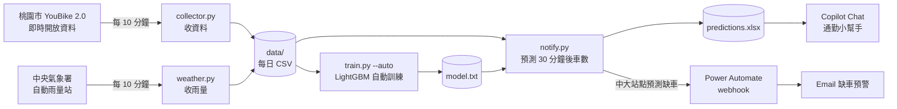

# 中大 YouBike 缺車／滿柱預警

> 用機器學習預測中央大學 YouBike 站點 **30 分鐘後** 的可借車數，預計缺車時主動通知學生，並建議提早出門、改去附近有車的站或改搭公車。

Microsoft × NCU AI 創新應用主題挑戰賽（AI for Better Campus & Life）參賽作品｜國立中央大學機器學習課程專題

---

## 為什麼做這個

中大學生在上下課尖峰時段，常常走到 YouBike 站才發現**沒車可借或沒位可還**，導致通勤時間增加，甚至上課遲到。

現有的查詢方式（包括官方 App）主要顯示**當下**的車數。但學生出門時真正需要知道的是：**等我走到站的時候，還有沒有車？**

## 我們怎麼做

| 一般查詢 | 本系統 |
|---|---|
| 自己打開 App，看到「現在」幾台 | 預計缺車時**主動通知** |
| 只告訴你這站有幾台 | 建議**提早出門、改去附近的站或改搭公車** |
| 一般時段資料 | 模型特徵放進**中大的上課節次**，專門針對校園通勤尖峰 |

## 系統架構



全部流程在 **GitHub Actions** 上自動執行：每次連續工作約 5.5 小時、每 10 分鐘一輪，結束前自動啟動下一輪，不需要任何人的電腦開著。

| 環節 | 檔案 | 執行方式 |
|---|---|---|
| 收資料 | `collector.py` | GitHub 自動，每 10 分鐘 |
| 收雨量 | `weather.py` | GitHub 自動，每 10 分鐘（自動挑離中大最近、有數值的雨量站） |
| 訓練正式模型 | `train.py --auto` | GitHub 自動：資料滿 7 天後開始，約每週一次；改了正式設定也會重訓 |
| 預測與通知 | `notify.py` | GitHub 自動，每 10 分鐘 |
| 缺車通知 | Power Automate（收到 Teams webhook 要求時 → 傳送電子郵件） | 自動 |
| 對話小幫手 | Microsoft 365 Copilot Chat，上傳 `predictions.xlsx` 並貼上指示 | Demo 前手動上傳最新預測檔 |
| 本機實驗 | `experiments.py`（一次跑完 v1–v5）或 `train.py --horizon … --shortage …` | 手動；結果寫進 `experiments.md`，不會動到正式模型 |
| 簡報素材 | `analyze.py`、`nearby.py` | 手動 |

## 模型

- **預測目標**：各站 30 分鐘後的可借車數；可借車數 ≤ 2 台視為「缺車」。
- **模型**：LightGBM 迴歸。
- **特徵**：站點、時段、星期、是否週末、**距離下一節課開始的分鐘數**（中大上課節次 08:00–19:00 每整點）、目前車數與總車柱、過去 10 / 20 / 30 / 60 分鐘的車數與變化、**近 10 分鐘與近 1 小時雨量**。
- **雨量缺值**：雨量資料從 2026/11/17 才開始收集，之前的時段沒有雨量；LightGBM 可直接處理缺值，實驗 v5（不用雨量）用來比較雨量特徵有沒有幫助。
- **基準（baseline）**：假設 30 分鐘後車數不變，也就是只看當下的即時車數。
- **評估**：依時間切分，前 80% 訓練、後 20% 測試，避免模型偷看到未來。指標為 MAE，以及缺車預警的 precision、recall。
- **保護機制**：新模型的缺車 recall 要高於基準、MAE 不能比基準差，才會取代正式模型。

### 結果

> 待 11/23 後以真實資料訓練並完成實驗後更新。完整實驗紀錄見 `experiments.md`（由 `python experiments.py` 自動產生）。

| 實驗 | 設定 |
|---|---|
| v1 | 正式設定（預測 30 分鐘、缺車門檻 2 台、含雨量） |
| v2 | 預測 60 分鐘後 |
| v3 | 缺車門檻 5 台 |
| v4 | 60 分鐘後 + 門檻 5 台 |
| v5 | 不用雨量特徵 |

| | MAE（台） | 缺車 precision | 缺車 recall |
|---|---|---|---|
| 基準（不變） | | | |
| LightGBM | | | |

## 通知的保護機制

- 同一站一小時內只通知一次
- 06:30 前、22:00 後不通知
- 最新資料超過 30 分鐘（例如收集中斷）就不通知，避免用舊資料誤報
- 只通知中大校內站點（`collect.yml` 的 `WATCH_KEYWORDS` 設定）

## 與其他做法的比較

**台大學生開發的「Ubike」App**：除了顯示各站車數，還能預測熱門站點的等車時間，做法是依據前一小時的租借情況推估（[INSIDE 報導](https://www.inside.com.tw/article/2833-ubike-app-case-study)）。

本作品的不同之處：

| | 台大學生的 Ubike App | 本作品 |
|---|---|---|
| 預測方式 | 用**前一小時**的租借情況推估 | 用持續累積的歷史資料訓練**機器學習模型**，並與「不變」基準比較、量化準確度 |
| 預測內容 | 熱門站點的等車時間 | 30 分鐘後的可借車數與缺車預警 |
| 校園情境 | 一般使用者 | 加入**中大上課節次**特徵，針對早八與下課尖峰 |
| 使用方式 | 使用者主動打開 App 查詢 | 預計缺車時**主動通知**，並由 Copilot 小幫手建議替代方案 |
| 運作方式 | App | 雲端全自動：收資料、重訓、預測、通知都不需人工 |

「預測車況」本身不是新點子，本作品的重點是**把預測轉成可以行動的決策建議，並主動送到學生手上**。

此外，北北桃曾規劃於 2026 年 1 月 1 日至 6 月 30 日試辦 YouBike「友愛接力」計畫：在無位可還的站借車，或在無車可借的站還車，可以獲得騎乘券；營運單位也表示即使增加調度，尖峰時段仍偶有無車可借或無柱可還的情況（[中央社報導](https://www.cna.com.tw/news/ahel/202512110100.aspx)）。本系統的預測可以提前告訴使用者哪裡快沒車、哪裡快滿柱，與這類調度政策互相配合。

## 擴充性

系統目前收集**中壢區與平鎮區**的站點資料（中大校園橫跨兩區，「中央大學國民運動中心」站屬於平鎮區），模型也是用這些站訓練。擴充只需要改設定，不需要重寫程式：

| 階段 | 範圍 | 要改什麼 |
|---|---|---|
| 現在 | 中大校內 3 站（圖書館、依仁堂、國民運動中心） | — |
| 下一步 | 中大通勤圈（周邊 1–1.5 公里） | `WATCH_KEYWORDS` 加入周邊站名 |
| 中期 | 中壢其他校園，例如中原大學 | 加關鍵字，`CLASS_STARTS` 換成該校節次 |
| 長期 | 整個桃園市，提供營運單位調度參考 | `collect.yml` 拿掉 `--area` 設定 |

## 在自己電腦上執行

```bash
pip install -r requirements.txt

python experiments.py                        # 一次跑完 v1–v5，結果寫進 experiments.md
python train.py                              # 用正式設定訓練（存成 model_local.txt，不上傳）
python train.py --no-weather                 # 實驗：不用雨量特徵
python train.py --horizon 60 --shortage 5    # 實驗：改預測時間與缺車門檻
python train.py --predict                    # 用正式模型預測，輸出 predictions.xlsx
python analyze.py shortage --keyword 中央大學 # 各時段缺車時間比例
python analyze.py plot --keyword 依仁堂 --official   # 實際 vs 預測對照圖
python nearby.py --km 1.5                    # 中大周邊站點清單
python weather.py --once                     # 測試雨量收集（需先設定 CWA_API_KEY）
```

正式設定（`HORIZON`、`SHORTAGE`、`CLASS_STARTS`）寫在 `train.py` 最上方。修改後提交並同步，GitHub 會自動用新設定重訓；也可以到 Actions 按「立即重新訓練」。

## GitHub Actions

| Workflow | 用途 |
|---|---|
| `collect.yml` | 主流程：收資料 → 自動訓練 → 預測 → 通知，接力不中斷 |
| `train-now.yml` | 手動立即重新訓練 |
| `test-notify.yml` | 送一則測試通知，確認通知流程正常 |

需要在 **Settings → Secrets and variables → Actions** 設定：

| Secret | 內容 |
|---|---|
| `WEBHOOK_URL` | Power Automate 流程的網址 |
| `CWA_API_KEY` | 中央氣象署資料開放平台的授權碼（免費註冊取得） |

沒有設定 `CWA_API_KEY` 時，系統會略過雨量、照常運作。

## 資料來源與授權

- 桃園市政府交通局「桃園公共自行車即時服務資料」（[政府資料開放平臺](https://data.gov.tw/dataset/28228)），依《政府資料開放授權條款－第 1 版》使用。
- 中央氣象署「自動雨量站－雨量觀測資料」（O-A0002-001，[政府資料開放平臺](https://data.gov.tw/dataset/9177)），依《政府資料開放授權條款－第 1 版》使用。
- 只使用站點層級的車數與雨量資料，不含任何個人資料。

## 限制

- 模型只能預測約 30 分鐘後，無法預測隔天或更遠的時間。
- 雨量資料較晚開始收集，雨天樣本累積前，雨量特徵的效果有限。
- Copilot Chat 小幫手的資料需要手動上傳（學校帳號沒有 Copilot Studio 授權）
- 預測可能有誤差，通知中會提醒使用者以現場為準。

## 團隊

| 成員 | GitHub | 已完成 | 進行中／預計 |
|---|---|---|---|
| 113403547 張茗崴（組長） | MingWei174 | 資料收集（`collector.py`、GitHub Actions 接力收集、擴充至中壢區與平鎮區）、模型訓練與自動重訓（`train.py`）、自動預測與 Power Automate 通知（`notify.py`）、雨量特徵（`weather.py`）、實驗程式（`experiments.py`）、缺車比例與預測對照圖（`analyze.py shortage／plot`）、周邊站查詢（`nearby.py`）、README | 執行實驗 v1–v5 並選定正式設定、整合簡報、與 Leon 一起錄製與剪輯 Demo 影片、決賽問答準備 |

| benson | benson12241224 | 還車滿柱預警（`train.py` 預測空位與滿柱預警、`notify.py` 通知同時列出缺車與滿柱）、Copilot Chat 小幫手指示與 10 題測試題（`copilot_instructions.md`） | 正式模型產出後執行小幫手測試 C（10 題，目標答對 ≥ 8 題）、 一起錄製與剪輯 60 秒 Demo 影片 、決賽問答準備 |

| 113403032 吳絃紘 | cool804 | 行事曆特徵（`calendar.csv`、`train.py` 加入放假與考試週特徵）、問卷分析程式（`survey.py`）、Forms 問卷建立與發放 | 行事曆特徵實驗結果寫入 `experiments.md`、問卷截止後（11/30）用正式資料統計並產出圖表 、 一起錄製與剪輯 60 秒 Demo 影片 、決賽問答準備 |

| 113403541 劉亮廷 | Leon159892 | 使用量分析（`analyze.py usage`，估計借出台數與星期 × 小時熱力圖）、實地驗證計算程式（`field_tests.py`） | 實地驗證（11/24–11/28，至少 3 個平日早上）、 一起錄製與剪輯 60 秒 Demo 影片 、決賽問答準備 |